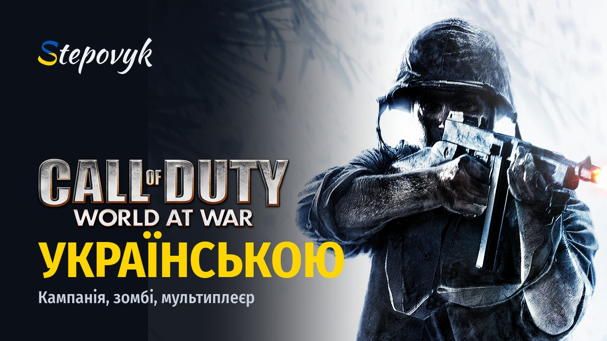
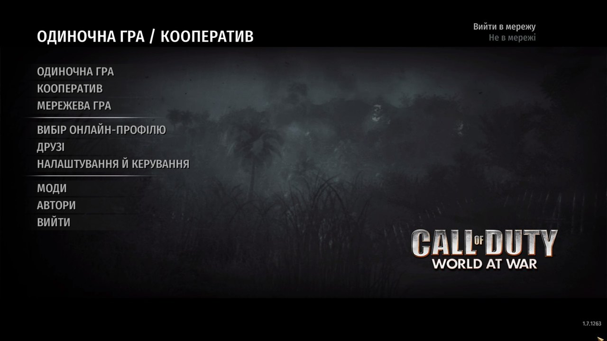
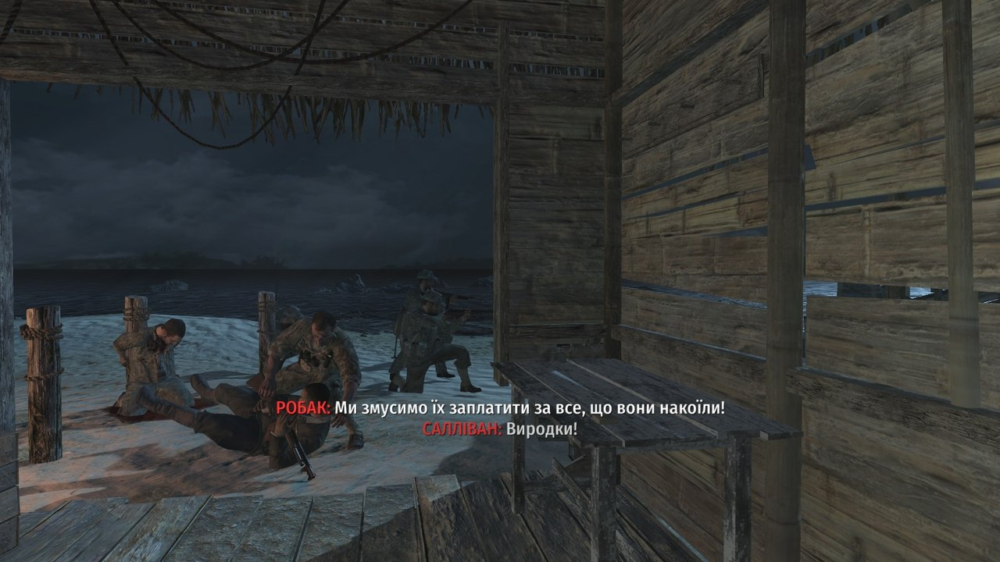
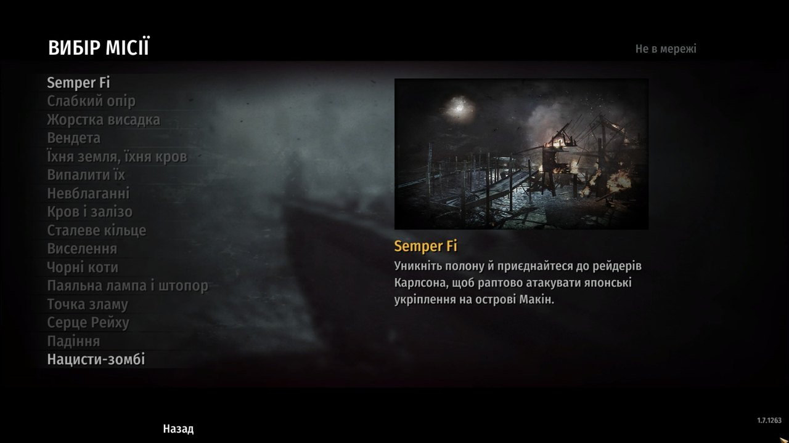
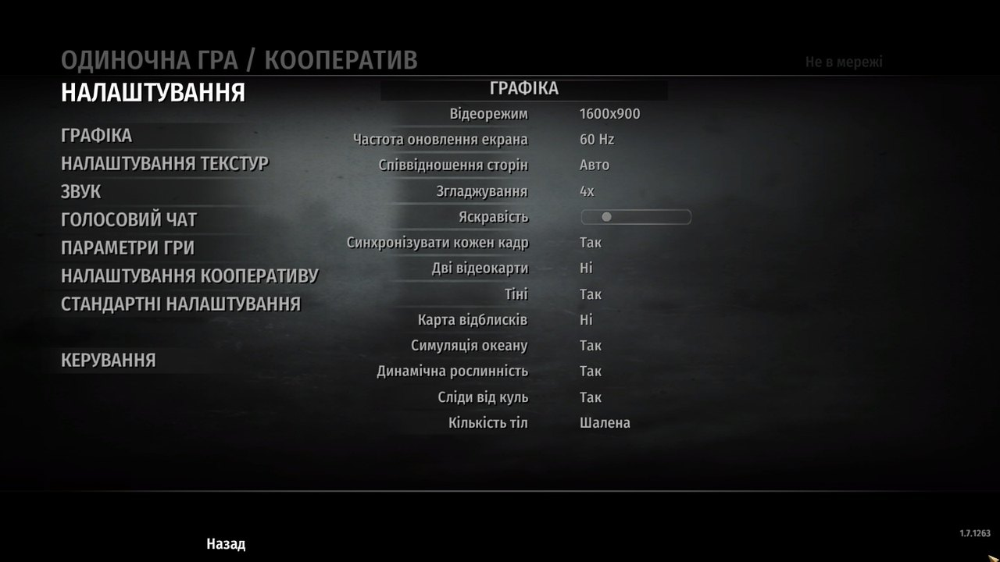
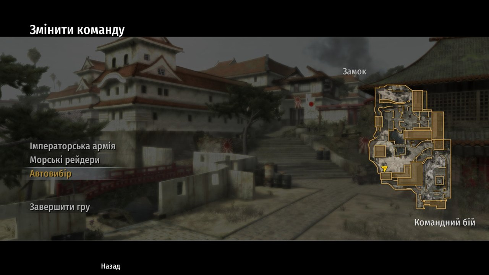
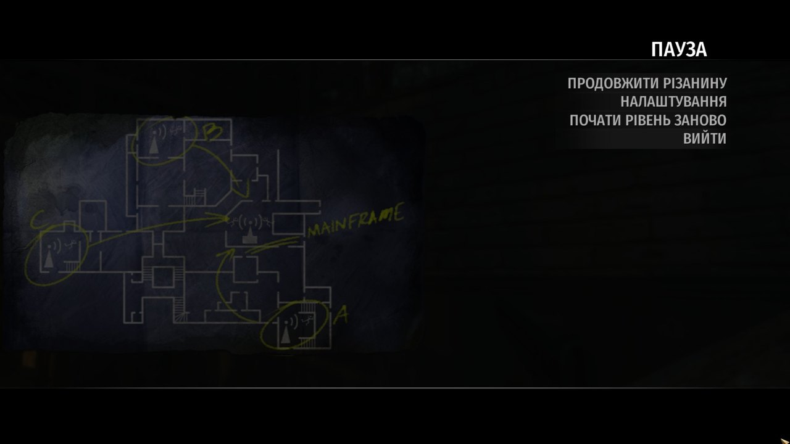

<p align="center"></p>

# Call of Duty: World at War українською

Повна українська локалізація Call of Duty: World at War для ПК.

**Версія:** 1.0.2 · **Гра:** 1.7 · **Автор:** Stepovyk

**[Завантажити інсталятор](../../releases/latest)**

[English below](#english)

## Що перекладено

- **Увесь текст гри.** Меню й налаштування, кампанія (субтитри, завдання, підказки, вступи до місій, цитати після загибелі), зомбі, кооператив, мультиплеєр, випробування, титри й системні вікна Windows. Понад 9 600 рядків.
- **Нові шрифти.** Усі шрифти гри перемальовано з повною кирилицею (і, ї, є, ґ, апостроф, «лапки»), рівні й чіткі навіть на великих екранах.
- **Жива мова.** Переклад пройшов окрему редактуру: військова лексика, звертання в кличному відмінку, природні репліки, а не дослівщина.

Голос і відеоролики лишаються англійськими, з українськими субтитрами.

## Як це виглядає

<p>






</p>

## Встановлення

1. Завантажте `WaW-Ukrainian-1.0.2.zip` з [Releases](../../releases/latest) і розпакуйте.
2. Закрийте гру й запустіть `WaW-Ukrainian-Setup.cmd`. Якщо Windows спитає, чи запускати файл, натисніть «Запустити».
3. Перевірте теку гри (ту, де лежить `CoDWaW.exe`) і натисніть **«Встановити»**.

Щоб повернути англійську, запустіть інсталятор ще раз і натисніть **«Видалити»**.

Потрібна гра версії 1.7 з англійською мовою (диск або Steam). Інсталятор не містить файлів гри: він акуратно змінює лише ваші власні файли, перевіряє версію перед змінами й уміє все повернути назад. Це звичайний відкритий скрипт PowerShell (`WaW-Ukrainian.ps1`), його можна прочитати будь-яким редактором.

## Підтримати

Переклад безкоштовний. Якщо хочете, щоб українською заговорили й інші частини Call of Duty, підтримайте роботу:

- **Monobank:** https://send.monobank.ua/jar/8aeC9dGFrn
- **Приват24:** https://www.privat24.ua/send/kkyqm

Новини, питання й нові переклади – у Telegram: [t.me/stepovyk_ua](https://t.me/stepovyk_ua). Помилку в перекладі можна надіслати і через [Issues](../../issues).

## Для розробників

```
python tools/build.py          # зібрати локалізацію з оригінальних файлів гри
python tools/install.py        # поставити в гру (оригінали зберігаються в backup/)
python tools/make_release.py   # зібрати інсталятор для гравців
```

Переклад лежить у `data/uk/*.json`, правила перекладу й глосарій – у `docs/guide.md` і `data/glossary.json`. Шрифти будує `tools/build_fonts.py`, латки exe – `tools/exepatch.py`.

---

## English

A complete Ukrainian localization of Call of Duty: World at War (PC, v1.7): menus, campaign subtitles and objectives, Nazi Zombies, co-op, multiplayer, credits and Windows dialogs, with redrawn game fonts that include full Cyrillic. Voice-over stays English with Ukrainian subtitles.

**Install:** download `WaW-Ukrainian-1.0.2.zip` from [Releases](../../releases/latest), unpack it, close the game, run `WaW-Ukrainian-Setup.cmd`, pick the game folder and press «Встановити» (Install). Press «Видалити» (Remove) to restore English. The installer is a plain, readable PowerShell script that ships no game files: it patches your own copy in place, verifies the game version first and can revert every change.

Unofficial fan project, not affiliated with Activision or Treyarch. Code and translation – MIT, see [LICENSE](LICENSE).
